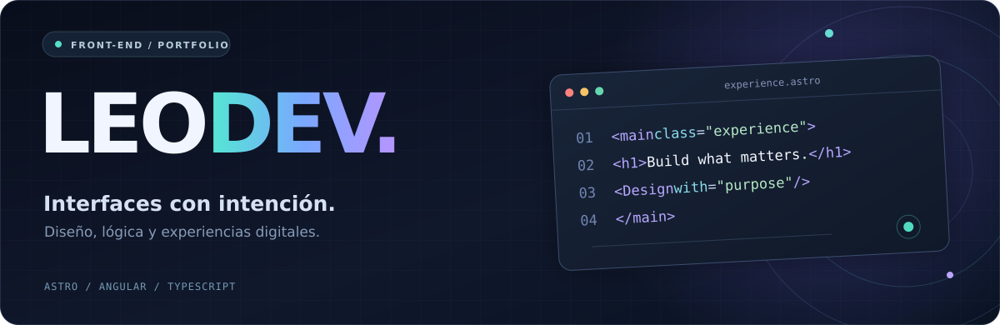

<!-- Perfil de Leo Dev · GitHub: Charls-Leo -->

  

  <a href="https://github.com/Charls-Leo?tab=repositories">Proyectos</a> &nbsp;·&nbsp;
  <a href="#sobre-mí">Sobre mí</a> &nbsp;·&nbsp;
  <a href="#tecnologías">Tecnologías</a> &nbsp;·&nbsp;
  <a href="#proyectos-destacados">Destacados</a>

  

## Sobre mí

Soy **Leo**, desarrollador **Front-End**. Disfruto transformar ideas en interfaces claras, atractivas y funcionales, cuidando tanto el diseño visual como la experiencia de usuario y la calidad del código.

Me interesan especialmente las experiencias web modernas, los detalles de interacción y los productos digitales que resuelven problemas reales.

- **Lo que construyo:** sitios web, interfaces de aplicaciones y prototipos interactivos.
- **Mi enfoque:** diseño responsive, componentes reutilizables, UX y buenas prácticas de desarrollo.
- **En lo que trabajo:** experiencias web con Astro y aplicaciones con Angular, TypeScript e Ionic.

## Tecnologías

**Lenguajes y Front-End**

  

**Datos y servicios**

  

**Diseño, desarrollo y despliegue**

  

**También utilizo:** Ionic · Jira · Trello · Canva · Windows Terminal · Google Stitch.

<b>Otras tecnologías y conocimientos</b>

 
Java · Spring Framework · Dart · Laravel · MariaDB · Oracle Cloud Infrastructure (OCI) · Programación orientada a objetos · Consumo de APIs.

## Proyectos destacados

<table>
<tr>
<td width="50%" valign="top">
  <h3><a href="https://github.com/Charls-Leo/Lujen-Prototype">01 — LUJEN</a></h3>
  
Prototipo de sitio web enfocado en identidad visual, diseño de interfaces y experiencias de navegación cuidadas.

  
<code>Astro</code> · <code>Front-End</code> · <code>UI</code>

  <a href="https://github.com/Charls-Leo/Lujen-Prototype">Explorar repositorio →</a>
</td>
<td width="50%" valign="top">
  <h3><a href="https://github.com/Charls-Leo/EcoRecolecta">02 — EcoRecolecta</a></h3>
  
Plataforma web para reportar incidencias relacionadas con residuos y facilitar su seguimiento y gestión.

  
<code>Angular</code> · <code>TypeScript</code> · <code>PostgreSQL</code>

  <a href="https://github.com/Charls-Leo/EcoRecolecta">Explorar repositorio →</a>
</td>
</tr>
<tr>
<td width="50%" valign="top">
  <h3><a href="https://github.com/Charls-Leo/EcoBa-Front-Conductor">03 — EcoBahía Conductor</a></h3>
  
Interfaz de aplicación móvil para conductores, con seguimiento de recorridos y ubicación GPS.

  
<code>Ionic</code> · <code>Angular</code> · <code>TypeScript</code>

  <a href="https://github.com/Charls-Leo/EcoBa-Front-Conductor">Explorar repositorio →</a>
</td>
<td width="50%" valign="top">
  <h3><a href="https://github.com/Charls-Leo/HBFirmaContable-web">04 — HB Firma Contable</a></h3>
  
Sitio web corporativo desarrollado con Astro, centrado en presentar servicios de manera clara y profesional.

  
<code>Astro</code> · <code>Web</code> · <code>Diseño</code>

  <a href="https://github.com/Charls-Leo/HBFirmaContable-web">Explorar repositorio →</a>
</td>
</tr>
</table>

## Mi forma de trabajar

`Explorar` → `Diseñar` → `Construir` → `Refinar` → `Entregar`

Me gusta combinar **pensamiento lógico, creatividad y atención al detalle** para crear productos que se sientan bien y funcionen mejor.

---

  <strong>Good design deserves good code.</strong> 
  Gracias por visitar mi perfil. Puedes explorar más proyectos en <a href="https://github.com/Charls-Leo?tab=repositories">mis repositorios</a>.

